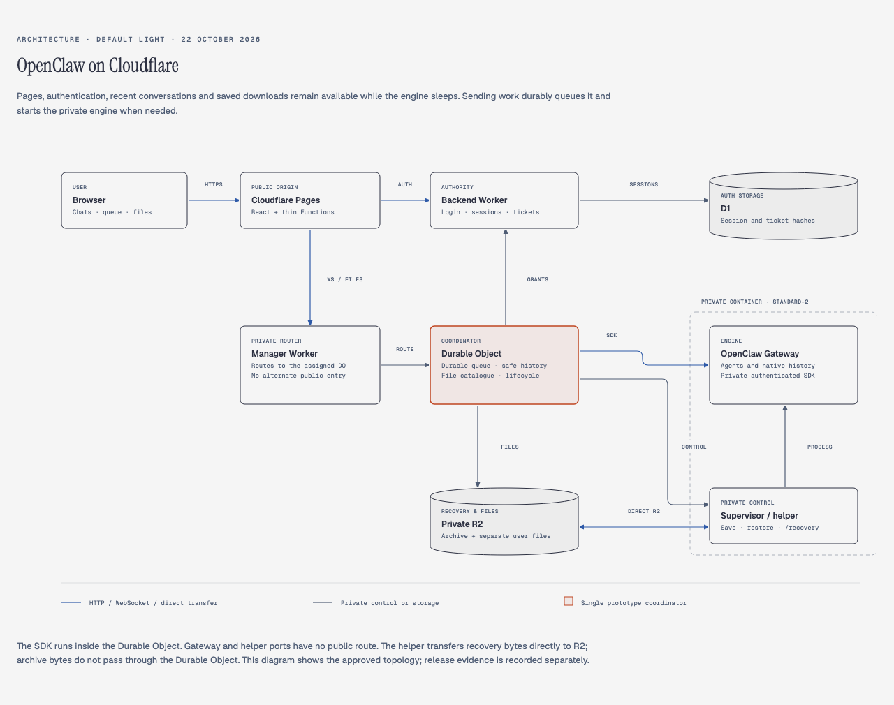

# Cloudflare architecture

The React application stays available on Cloudflare Pages while OpenClaw sleeps.
A Backend Worker owns login and authorization in D1. A private Manager Worker routes
to one SQLite Durable Object and its attached OpenClaw container. The Durable
Object owns accepted work, safe recent history, file metadata and preservation.
This prototype has one configured account and one manager/container pair.

[Open the default-light architecture diagram](diagrams/openclaw-cloudflare-architecture-2026-10-22.html).

The diagram describes implemented topology, not proof of a completed production
release. See [release verification](release-verification.md) for observed evidence.

## Responsibility and authoritative data

| Component                    | Authority and responsibility                                                                                                                                                |
| ---------------------------- | --------------------------------------------------------------------------------------------------------------------------------------------------------------------------- |
| Pages React                  | UI, route-stable drafts and display projections; no provider or engine secrets                                                                                              |
| Thin Pages Functions         | Same-origin route forwarding through private service bindings                                                                                                               |
| Backend Worker / D1          | Password verification, opaque sessions, owner-to-manager assignment, connection tickets, grants and download permissions                                                    |
| Manager Worker               | Route to the assigned manager; no independent login authority                                                                                                               |
| SQLite Durable Object        | Chat mappings, durable pending queue, command identities/receipts, settings operations, browser-safe history, file catalogue, reader pins and lifecycle/recovery references |
| OpenClaw Gateway / agents    | Submitted execution, canonical transcripts, native settings, identities and meaningful workspace state                                                                      |
| Authenticated private helper | Supervise Gateway, exact-device approval, verified file access, capture/restore and direct R2 transfers                                                                     |
| Private R2                   | Recovery archive/manifest, separate user-file objects and browser upload staging                                                                                            |

The shared contracts define browser DTOs. The portable ChatService uses SQLite
repositories without process-driven background reconciliation in the DO. Named
persisted deadlines compose lifecycle, authorization and other work onto the DO's
single alarm. Network operations remain outside SQL transactions; native
`transactionSync` gives coherent nested rollback and final lifecycle fences.

The browser uses HTTP only for authentication, connection tickets and independently
authorized file delivery. Chats, messages, queues, settings, model selection,
attachments, file catalogue and older-history operations use one authorized
manager WebSocket. There is no browser-to-Gateway or browser-to-helper connection.
Static assets bypass Functions; explicit dynamic routes include `/api` as well as
`/api/*`. Unknown API requests return JSON errors, not SPA HTML. Ordinary deep
links serve the React application. Alternate public Worker URLs are disabled.

## Login, socket admission and access renewal

1. The browser posts its username/password to the same-origin backend facade.
   The Backend verifies the salted scrypt hash and issues a random 256-bit opaque
   session value. D1 stores its SHA-256 hash, expiry and revocation state.
2. The browser receives `__Host-messenger_session`: Secure, HttpOnly,
   SameSite=Lax, root path and no Domain attribute. The default session lifetime
   remains 86,400 seconds; the manager cannot extend it.
3. `POST /api/connection-tickets` returns a fresh single-use ticket valid for
   **60 seconds**, bound to the exact session, origin and assigned manager.
4. The browser opens `/ws/conversation?ticket=…`. Before accepting the upgrade,
   the manager asks the Backend to atomically consume the ticket and verify the
   session and assignment. Failure or backend unavailability rejects admission.
5. The Backend grants at most **15 minutes**, capped by the original session
   expiry. Every referenced chat, command, upload and file still requires
   ownership checks. A permitted socket may work with multiple owned chats.
6. The DO requests renewal from the Backend. Per-command grant checks fail
   closed; backend revocation also notifies the manager to close sockets. Expiry
   bounds exposure if notification is lost. Application authorization closure
   uses code `4001`; the browser also handles legacy `1008`.

A lost admission response does not make a consumed ticket reusable. Each tab,
connection and reconnect obtains a new ticket. Login, socket admission, cached
history and file listing do **not** wake OpenClaw. Logout/expiry ends browser
access but does not cancel already accepted queued or executing work.

## Credential roles and the native private connection

| Credential                    | Purpose and placement                                                                    |
| ----------------------------- | ---------------------------------------------------------------------------------------- |
| Application password hash     | Backend secret; user authentication only                                                 |
| Session / short-lived tickets | Backend authority; browser receives only its own opaque values                           |
| Gateway token                 | Initial private Gateway authentication and applicable management operations              |
| Manager Ed25519 key pair      | Persistent DO device identity; signs fresh native authentication challenges              |
| Issued native device token    | Persisted in the DO and reused for subsequent authorized native connections              |
| Helper token                  | Separate private HTTP control; excluded from Gateway and native CLI child environments   |
| Provider API keys             | Server-side engine execution only; never in frontend artifacts                           |
| R2 S3 credentials             | DO-only signer; helper receives narrow expiring method/object grants, never account keys |

`@openclaw/gateway-client/browser` runs inside the DO over the native private
container Fetcher WebSocket. Internal Gateway TLS is disabled on that private
route; public browser access remains HTTPS/WSS. The helper uses a separate
bearer-authenticated HTTP interface. Neither port is publicly routed. The failed
custom TLS adapter and helper WebSocket bridge are excluded.

The helper approves only the persisted expected public key, device identity,
operator role and exact scopes. Silent local pairing is disabled; native client
metadata is `gateway-client` / `cli`, avoiding the pinned local-backend bypass.
Trust records, manager identity and issued token survive restored boots. The SDK
is transport/authentication, not an alternative user/session authority.

OpenClaw and SDK are pinned to **2026.10.1**; the image is digest-pinned. Production
container size is **standard-2: 1 vCPU, 6 GiB memory, 12 GB disk**. Upgrades must
revalidate native authentication, pairing, recovery and private full-message
reader imports against that exact image; npm bundle filenames differ from the
image despite the same version number.

## Accepted work and readiness

The manager commits accepted sends and creation intents before acknowledging,
without waiting for engine startup. A durable acknowledgement ends the generic
15-second delivery/resubmit timer. Send remains available within the existing
20-pending-message-per-chat limit; sleeping/warming is ordinary queued work.
Socket readiness, running container, running Gateway and usable authenticated
engine are distinct states. Only final engine readiness opens dispatch.

New chat materialization first recovers the deterministic native identity, records
creation uncertainty and persists the confirmed mapping. Submission intent is
saved before native RPC. A lost response is an unknown outcome, reconciled using
canonical receipts; it is never blindly replayed. Queue edits preserve position
and revision guards. Settings retain wait-until-idle/cancel-work semantics.
Deleting a chat removes confirmed owned native state and the active projection,
while tombstones and mutation receipts remain to fence delayed retries. This is
not complete storage erasure or exactly-once execution.

Native pending-input receipts can omit directly started inputs, and consumption
alone proves ingestion rather than completion. The native adapter requires the
original saved native session, a canonical user event with both a stable ID and
positive sequence, and an exact accepted-input identity. It resolves the direct or
steered owner, then requires a later stable assistant event for that same owner:
`stopReason: stop`, absent/final channel, no tool call or error, and no active owner.
Explicit pending evidence takes precedence. Text equality, a terminal stream frame,
or an interrupted user journal entry cannot settle accepted work. Length limits,
provider errors and unproven restart outcomes remain uncertain and fence successors.
Native identity metadata stays private before browser projection.

Queued native followups can execute under a generated owner different from both
the parent run and accepted input UUID. The pinned image applies a guarded
build-time metadata compatibility patch: exact protected source keys bind that
owner through native's ordinary persistence timing, and the existing provider
barrier requires the committed proof. It changes no admission or scheduling
behavior. All seven original module hashes and insertion contexts are checked
before any write; the image includes a before/after compatibility manifest.
This private association still requires the later successful causal final above;
metadata alone does not prove completion. See [native compatibility](native-compatibility.md) for pins and validation limits.

Explicit Stop and cancel-work use a separate cancellation boundary. Before native
abort, the app durably records the exact pending rows, revisions, submission IDs,
original native session and confirmed owners. A matching authoritative
execution acknowledgement confirms that intent only with fresh canonical owner
equality. A separate typed pre-execution certificate can confirm the exact
original input before its canonical USER exists; generic IDs cannot do so.
Generated followups can have different logical input and execution IDs. The app first uses the existing
exact-run selector, commits a matching execution ACK before its next await, then
always retains the original key-only session-wide queue/cascade cleanup. It never
translates a logical ACK into execution authority. Grouped inputs share one exact
owner request; target failures cannot skip broad cleanup or erase prior proof. The official
rich chat abort sits between targeted aborts and broad cleanup. Typed certificates
are scoped to the original Stop nonce, pending tuple and native session; fresh
pending/active or contradictory owner evidence still prevents settlement.
Execution ACK settlement still requires unchanged rows/session, the same fresh
canonical owner and an inactive owner. Typed settlement additionally seals the
original request nonce before the history read and permits no canonical USER only
with the exact pre-execution certificate and fresh inactive, uncontradicted scope.
Lost/no-active acknowledgements, unscoped native cancellation, reset sessions, remapped
owners and newly accepted work cannot inherit this authority.

Fresh Steer admission durably saves the effective selected/default behavior and an
eligible ready active target in the acknowledgement transaction. Dispatch may use
only that exact target and revision, once. Edits, different runs and reconstructed
uncertainty cannot retarget it; ordinary queued predecessors do not suppress a
valid busy Steer, while unresolved-delivery fences remain stronger.

## Sixty-second idle, preservation and option B cancellation

`ENGINE_IDLE_SECONDS=60` measures genuine inactivity: no queued/active agent work,
uncertain dispatch, settings mutation, file handoff or relevant tracked work.
Open sockets and cached reads do not keep the engine awake. Native state and
cooperative suspension supplement manager records; browser silence is not proof.

1. Gate native dispatch while still durably accepting authorized queued work.
2. Call `gateway.suspend.prepare` and renew its 120-second protection lease while
   draining. Status polling alone does not renew it.
3. Gracefully stop Gateway and relevant writers, keeping the helper alive. Verify
   engine-UID processes and writable recovery descriptors, including detached
   children. Remaining/unverifiable writers refuse capture without killing
   unrelated processes.
4. Capture coherent state, validate inventory/SQLite, upload changed objects
   directly from helper to R2, and stream-read complete checksums for verification.
5. Atomically commit the coherent recovery reference. Recheck pending work and
   admitted readers in the same final stop fence, then issue container destroy.

**Option B cutoff is final Cloudflare stop issuance.** Before that durable fence,
new work cancels preservation. Cancel and settle outstanding helper jobs first.
If Gateway is alive, release preparation; otherwise restart from **current local
files**. Never restore an older R2 checkpoint over newer local state. After stop
has been issued, or its outcome is uncertain, reconcile shutdown before starting
and restoring. Boot/attempt/job IDs and cancellation tombstones reject stale or
late results. An arriving message cannot race an unrecorded final stop.

Save failures retain local data and the previous valid reference, settle uncertain
operations, restart locally when safe and defer another attempt (30-second
backoff). They never destroy the only current copy. Supervision is reapplied after
DO reconstruction; monitoring and inactivity settings prevent platform eviction
from bypassing preservation. Recovery verification refreshes supervision every
20 seconds independently of its bounded verification operation.

## What recovery preserves

All meaningful HOME, configuration, trust/identity records, agent instructions,
settings, native sessions/transcripts, SQLite plus required WAL/SHM/journals,
memory, schedules/jobs, uploads, private working/intermediate files and unknown
meaningful files live beneath `/recovery`. Only explicitly rebuildable cache/tmp
material is excluded. Configured paths and resolved symlinks cannot escape into
excluded trees. Preservation is independent of browser publication and upload
limits.

Each generation contains one internal `.tar.gz` archive and a manifest plus separate
R2 user-file objects. Files beneath configured documents roots are separated for
possible asleep downloads; this separation alone never publishes them. Unknown
private files elsewhere stay in the archive. Original paths, contents, ownership,
modes, safe symlinks and deletions survive. Hard-linked contents survive without
promising inode identity; ACLs, xattrs and timestamps are outside logical recovery.
This restores logical state, not RAM, an instruction pointer or an uninterrupted
running task. SQLite checks use expendable private copies and sidecars under the
pinned Node runtime, never mutate the source database.

The helper streams bytes directly through exact-method/key expiring S3 grants;
archives never pass through the DO. The helper directly reads back every uploaded
or reused object with signed GET grants and checks complete size/SHA-256 before
returning a constant-size digest of the exact verified object tuples. The manager
checks that receipt and R2 HEAD size/MD5 metadata; it never reads the recovery body.
Multipart ETags are not whole-file hashes. New file keys are generation-qualified immutable
`files/<generation>/<sha256>`; unchanged files reuse only the exact currently
committed incarnation. This prevents a delayed old deletion erasing later content.

Keep one latest completed generation. Retain the previous valid generation during
replacement, then delete only when no committed/pending operation, catalogue or
admitted reader references an object. Uncertain commits/deletes remain fenced
until reconciled. There is no per-edit, per-task or periodic engine upload.

## Wake, restoration and crash boundary

Start the container with **only the helper**. Read the latest committed descriptor,
restore every archive/file to original locations, verify inventory, hashes,
ownership, SQLite, identities and attachments, then start Gateway. Authenticate,
restore subscriptions, reconcile receipts and open dispatch only when usable.
Defaults apply only to a proven pristine first boot. An initialized engine that
loses disk before its first checkpoint must fail closed; it cannot silently
become an empty engine. Failed restoration leaves Gateway stopped and accepted
work retained. Unexpected loss restores the latest completed generation; unsaved
engine changes can be lost. Cached history is not proof that execution succeeded.
Schedules/jobs are preserved, but automatic scheduled wake remains deferred.

## Safe recent history and file publication

The DO persists browser-safe whole user/assistant messages sufficient for about
**two measured viewport screens**, considering content and layout. There is no
fixed 15/50/200-message retention policy. Explicit older uncached history may wake;
initial history never does. Native record anchors keep paging stable after new
messages. Completed long messages are rehydrated beyond native display limits and
sent in ordered fragments; transport pages/bytes do not truncate canonical history.
An exact-session helper reader handles messages beyond native API display caps.

Safe projection occurs **before** live streaming, caching, replay and errors. Raw
Gateway frames, tool arguments/results, system configuration, private native paths
and credentials remain private. Split-chunk file references become `file:<opaque
application ID>`. Internal-file activity is suppressed entirely. Only supported,
authoritatively classified activity yields concise tool summaries; unknown files
remain private even when relevant native events were missed during manager outage.

A generated deliverable requires observed successful eligible write/edit evidence,
an exact configured agent documents root, verified realpath/inode and credential
content audit. Mere directory placement is insufficient. Inputs receive equivalent
publication checks: native edits making them private invalidate stale staged
fallbacks. Failed publication never removes meaningful bytes from preservation.
DO-only R2/private signing secrets never enter helper bodies. Redacted settings
and queued text preserve unchanged canonical values; partial placeholder edits
fail safely rather than overwrite hidden content.

## Uploads and one-minute application downloads

Upload chunks travel over the authorized socket into private R2 staging, without
waking. Quota reservation precedes bytes; completion requires stored bytes and
durable metadata. Limits remain five files/message, 5 MiB/file, 10 MiB/message,
100 MiB/200 uploads/account and one-hour unused expiry. Accepted references remain
retained. These are browser limits, never engine preservation caps.

Send binds attachments transactionally, wakes/joins the engine and hands verified
files to the intended native agent/session before dispatch. Stable private session
files avoid the pinned inline-base64 payload ceiling; the submission-specific
native appendix is removed exactly from browser history. Original attachment
metadata is reconstructed only from exact session/submission/marker provenance;
immutable retries cannot substitute names or bytes, and no helper paths cross
the browser boundary. Handoff uses bounded concurrency/backpressure and idempotent
identities.

PDF inputs need private native-readable companions because the pinned read tool
cannot consume original binary PDF paths. The helper invokes the immutable image's
PDF extractor in an isolated uid 1000 process, creates private text/PNG companions
from a verified immutable source snapshot and preserves the exact original PDF
bytes for downloads/recovery. A small private submission appendix identifies the
companions and is stripped exactly from public history. This supports the approved
aggregate upload size without an inline-base64 transport overflow. Extraction is
bounded to 4 pages, 4 million pixels and 60,000 characters; incomplete, corrupt, password-
protected or disabled extraction fails explicitly. Text-only models can use
available text with a visual limitation; scanned/no-text content requires image
support. Companions never enter the public file catalogue. The pinned extractor
module, like the private full-message reader, must be revalidated on image upgrades.

Every download obtains a **Backend-issued, single-use permission expiring exactly
60 seconds after issuance**, bound to the exact originating login session and
eligible opaque file. The application returns `/downloads/<ticket>` and streams
through the manager, with no R2 redirect or native path. Admission atomically
consumes permission and checks that original live session; a different tab/session
cannot reuse it. A socket grant does not authorize separate HTTP requests.

When local files are usable, the helper audits and spools the current eligible
inode; no older R2 version silently substitutes for live data. While asleep or
restoring, serve the audited committed R2 object **without waking**. Source reader
pins delay final stop/GC. An admitted stream may finish after ticket/session expiry
or logout. Before headers, a durable pin covers bounded audit/spool; after headers,
progress renews a 90-second body-inactivity lease. Memory remains bounded.

## Logging and operational boundary

Log only controlled route names, generated correlation IDs and sanitized outcomes.
Never log request URLs, ticket-bearing paths/queries, cookies, authorization,
credentials or raw upstream payloads. Worker invocation URL logs and traces are
disabled; query redaction is also configured. Pages real-time tail envelopes expose
raw URL/headers even though the platform does not retain those sessions. Do not
start request tails on production admission/download traffic or attach retaining
monitoring sinks. Sentinel success/rejection/replay checks belong to the release
record, not an assumption that platform tails redact secrets.

See [operations](operations.md), [testing](testing.md), [decisions and tradeoffs](decisions-and-tradeoffs.md)
and [historical evidence](implementation-status.md). Multi-user allocation, custom
domain setup, importing deleted deployment data, stronger crash durability and the
advanced wake-failure/manual-retry UI remain outside this implementation.
